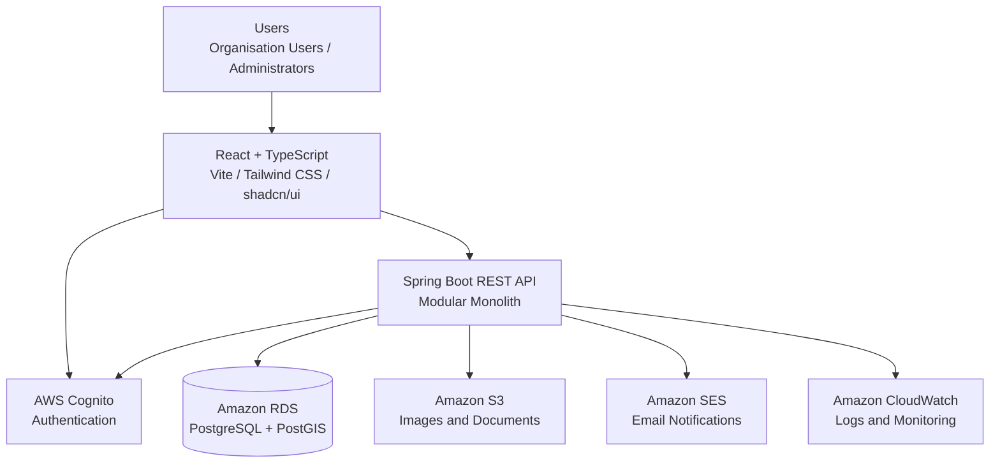
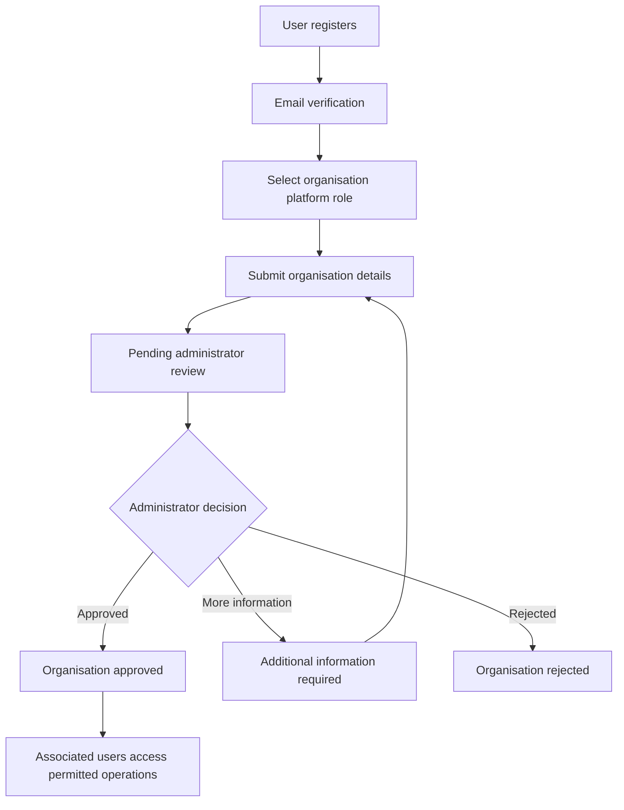
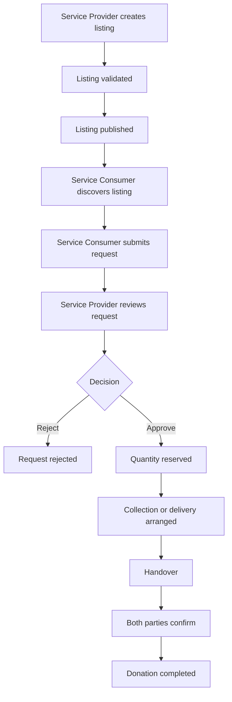

# Last Plate – Software Architecture Document (SAD)

**Version:** 1.1  
**Status:** Accepted  
**Product:** Last Plate  
**Initiative:** Y2iH – Year To Improve Humanity  
**Architecture Style:** Modular Monolith with Layered Architecture and Clean Architecture Principles

---

## 1. Introduction

### 1.1 Purpose

This document describes the technical architecture and implementation approach for Last Plate.

It translates the approved Product Requirements Document (PRD) into a technical design that will guide implementation, testing, deployment and future maintenance.

The architecture must support a functional hackathon MVP while allowing Last Plate to evolve without requiring a complete rewrite.

### 1.2 Architectural objectives

The architecture must:

1. Support Service Providers and Service Consumers through a simple, accessible platform.
2. Maintain clear separation between frontend, business logic and infrastructure.
3. Protect food donation workflows against incorrect quantities and duplicate reservations.
4. Support location-based food discovery.
5. Provide secure authentication and organisation approval.
6. Support individual user accounts associated with organisations.
7. Enforce clear separation between Service Provider and Service Consumer responsibilities.
8. Use AWS services where they provide practical value.
9. Remain straightforward to develop, test, deploy and maintain.
10. Allow future functionality to be introduced without unnecessarily complicating the MVP.

---

## 2. Architecture Overview

### 2.1 Selected architecture

Last Plate will use a **Modular Monolith with Layered Architecture and Clean Architecture principles**.

The application will consist of:

- One React frontend application.
- One Spring Boot backend application.
- One PostgreSQL database.
- AWS-managed services for authentication, storage, email and hosting.

The backend will be deployed as a single application. Internally, it will be divided into independent business modules with clearly defined responsibilities.

We will not introduce microservices for the MVP.

### 2.2 Architectural principles

| Principle | Application |
|---|---|
| Separation of concerns | Frontend, application logic, domain rules and infrastructure remain separate. |
| Modular design | Business capabilities are grouped into independent modules. |
| Dependency direction | Domain and application logic must not depend on infrastructure implementations. |
| Single responsibility | Each module owns a defined business capability. |
| Explicit boundaries | Modules interact through defined interfaces and application services. |
| Simplicity | Avoid unnecessary abstractions, services and dependencies. |
| Testability | Business rules must be testable without requiring AWS or a running database. |
| Security by design | Authentication, authorisation and data protection are built into the architecture. |
| Organisation separation | Organisation platform roles determine which donation operations are permitted. |

### 2.3 High-level architecture



The frontend communicates with the backend through REST APIs. Authentication is handled by Amazon Cognito, while the backend validates access tokens before allowing protected operations.

The backend owns business rules and data access. The frontend must never be treated as the authority for permissions, organisation approval, donation quantities or workflow status.

The organisation's platform role is maintained by the application and is separate from the user's authentication identity.

---

## 3. Technology Stack

### 3.1 Frontend

| Technology | Responsibility |
|---|---|
| React | User interface and component management |
| TypeScript | Type safety and maintainability |
| Vite | Development server and frontend build tooling |
| Tailwind CSS | Styling and responsive layouts |
| shadcn/ui | Reusable interface components |
| React Router | Frontend navigation |
| TanStack Query | API requests, caching and server-state management |

The frontend will be a separate application from the Spring Boot backend.

### 3.2 Backend

| Technology | Responsibility |
|---|---|
| Java 21 | Backend programming language |
| Spring Boot | Application framework |
| Spring Web | REST API endpoints |
| Spring Security | API security and JWT validation |
| Spring Data JPA | Database persistence |
| Hibernate | ORM implementation |
| Maven | Dependency and build management |
| Bean Validation | Request validation |
| JUnit 5 | Unit and integration testing |
| Mockito | Dependency mocking |

Application configuration will use YAML.

Lombok will not be required. Prefer explicit constructors, fields and methods for straightforward debugging and maintenance.

### 3.3 Database

**PostgreSQL with PostGIS**

PostgreSQL will store application data, while PostGIS will support geographical queries.

Examples include:

- Finding available food donations near a Service Consumer.
- Filtering donations within a specified distance.
- Ordering listings by proximity.
- Supporting future geographical reporting.

### 3.4 AWS services

| AWS service | Responsibility |
|---|---|
| Amazon Cognito | User authentication and token issuance |
| Amazon RDS | Managed PostgreSQL database |
| Amazon S3 | Food photographs and organisation documents |
| Amazon SES | Transactional email notifications |
| AWS App Runner or another suitable application hosting option | Backend deployment, subject to final deployment validation |
| Amazon CloudWatch | Application logs and monitoring |

The frontend will also require a hosting solution. Its final hosting service will be selected during deployment planning.

AWS services must be configured with appropriate permissions, environment-specific settings and cost controls.

---

## 4. Application Structure

### 4.1 Frontend structure

The frontend will be organised by business feature rather than placing all screens into one large component directory.

Proposed structure:

```text
frontend/
├── public/
├── src/
│   ├── app/
│   │   ├── App.tsx
│   │   ├── router.tsx
│   │   └── providers.tsx
│   │
│   ├── components/
│   │   ├── layout/
│   │   ├── common/
│   │   └── ui/
│   │
│   ├── features/
│   │   ├── authentication/
│   │   ├── organisations/
│   │   ├── donations/
│   │   ├── discovery/
│   │   ├── requests/
│   │   ├── handovers/
│   │   ├── administration/
│   │   └── reporting/
│   │
│   ├── services/
│   │   ├── api/
│   │   └── auth/
│   │
│   ├── hooks/
│   ├── types/
│   ├── lib/
│   ├── styles/
│   └── main.tsx
│
├── package.json
└── vite.config.ts
```

The frontend is responsible for presentation, user interaction, form validation and displaying backend responses.

It must not independently implement authoritative business rules.

### 4.2 Backend structure

The backend will use feature-based modules with internal application, domain and infrastructure separation.

Proposed structure:

```text
backend/
└── src/
    └── main/
        ├── java/
        │   └── za/co/y2ih/lastplate/
        │       ├── LastPlateApplication.java
        │       │
        │       ├── modules/
        │       │   ├── identity/
        │       │   ├── organisation/
        │       │   ├── foodlisting/
        │       │   ├── discovery/
        │       │   ├── donation/
        │       │   ├── delivery/
        │       │   ├── handover/
        │       │   ├── trustandsafety/
        │       │   └── reporting/
        │       │
        │       └── infrastructure/
        │           ├── security/
        │           ├── persistence/
        │           ├── storage/
        │           ├── email/
        │           ├── configuration/
        │           └── web/
        │
        └── resources/
            ├── application.yml
            ├── application-local.yml
            ├── application-test.yml
            └── db/
                └── migration/
```

The proposed Java package namespace is provisional and must be confirmed before project creation.

### 4.3 Internal module organisation

Where a module needs layered separation, use the following structure:

```text
donation/
├── application/
│   ├── port/
│   │   ├── in/
│   │   └── out/
│   └── service/
│
├── domain/
│   ├── model/
│   ├── service/
│   └── exception/
│
└── infrastructure/
    ├── persistence/
    └── web/
```

Not every module needs every directory.

Interfaces should be introduced at meaningful boundaries, such as persistence, external services and use-case contracts. Avoid creating an interface for every class.

---

## 5. Backend Module Responsibilities

| Module | Responsibility |
|---|---|
| Identity | Application user context, user accounts, organisation membership, permissions and Cognito integration boundaries |
| Organisation | Organisation registration, profiles, platform roles, verification and approval |
| Food Listing | Creation, modification, publication and withdrawal of food donations |
| Discovery | Nearby donation searches, filters and location-based queries |
| Donation | Donation requests, approval, rejection, reservation and lifecycle |
| Delivery | Collection and delivery arrangements, including delivery fees |
| Handover | Collection confirmation, delivery confirmation and actual quantities |
| Trust and Safety | Reports, disputes, suspension, investigation and audit records |
| Reporting | Platform statistics and impact reporting |

### 5.1 Module ownership

Each module owns its business responsibilities and data.

For example:

- Identity owns application user accounts and organisation membership.
- Organisation owns organisation profiles, platform roles and verification.
- Food Listing owns donation listing information.
- Donation owns request approval and quantity reservation.
- Delivery owns delivery arrangements and agreed fees.
- Handover owns the final transfer confirmation.

A module must not directly modify another module's database tables.

Cross-module operations should use application services or explicitly defined interfaces.

The modules operate within one relational database and one application deployment. Module ownership represents logical responsibility, not separate databases or independently deployed services.

### 5.2 Organisation platform roles

Every organisation must register under one of two platform roles:

**Service Provider**

An organisation that makes surplus food available to other organisations.

Responsibilities include:
- Managing its organisation profile.
- Publishing food listings.
- Reviewing donation requests.
- Approving or rejecting requests.
- Coordinating collection or delivery.
- Confirming handovers.

**Service Consumer**

An organisation that receives food donations to support soup kitchens and community feeding activities.

Responsibilities include:
- Managing its organisation profile.
- Discovering available food listings.
- Requesting donations.
- Coordinating collection or delivery.
- Confirming received handovers.

An organisation must have one platform role only. The same organisation profile cannot operate as both a Service Provider and Service Consumer.

Organisation category and platform role are separate concepts. For example, a supermarket is an organisation category, while Service Provider is its platform role.

### 5.3 Organisation membership

Individual users must have their own application accounts and must be associated with an organisation to perform organisation-specific operations.

The organisation membership relationship must support:

- Linking an authenticated user to an organisation.
- Identifying the organisation the user represents.
- Assigning the user's permitted actions.
- Enforcing organisation ownership.
- Preventing unauthorised access to other organisations.

Multiple individual users may be associated with the same organisation.

The organisation's platform role determines which business operations its associated users may perform.

Independent individual food-provider accounts are outside the MVP.

---

## 6. Data Architecture

### 6.1 Database approach

The application will use one PostgreSQL database.

The MVP will use a relational data model with foreign keys, constraints and transactions to protect data integrity.

PostGIS will provide geographical functionality.

Database migrations will be version-controlled and applied consistently across environments.

### 6.2 Core data entities

The initial logical data model will include:

| Entity | Purpose |
|---|---|
| User | Application user profile and Cognito identity reference |
| Organisation | Organisation profile and platform role |
| Organisation Membership | Association between individual users and organisations, including assigned permissions |
| Organisation Verification | Verification information and approval history |
| Food Listing | Surplus food available for donation |
| Food Listing Image | References to photographs stored in S3 |
| Donation Request | A Service Consumer's request for a food listing |
| Delivery Arrangement | Collection or delivery details and agreed fee |
| Handover | Final transfer record |
| Handover Confirmation | Confirmation by the Service Provider and Service Consumer |
| Report | Reported concerns or incidents |
| Audit Log | Important administrative and business events |

This is a logical entity list, not a final physical database schema. Field definitions, relationships, indexes and constraints will be finalised during implementation design.

### 6.3 Identity management

Amazon Cognito will be the identity provider.

The application database will store the user's application profile and a reference to their Cognito identity.

Authentication credentials will not be stored in the Last Plate database.

The backend will validate Cognito-issued JWT access tokens and use the authenticated identity to retrieve the relevant application user and organisation membership.

Organisation roles, membership and application permissions must be maintained by the application rather than relying exclusively on authentication token claims.

### 6.4 Geographical data

Organisation and food listing locations will be stored as geographical coordinates.

PostGIS will support proximity searches.

The application must distinguish between:

- Public or approximate location information.
- Exact collection or delivery addresses.

Exact addresses must only be exposed to authorised parties when the donation request reaches the appropriate approved stage.

### 6.5 File storage

Food photographs and organisation documents will be stored in Amazon S3.

The database will store file metadata and object references rather than binary file content.

Uploads must be authorised, validated and restricted by file type and size.

Private organisation documents must not be publicly accessible.

---

## 7. Authentication and Authorisation

### 7.1 Authentication flow

1. A user registers or signs in through Amazon Cognito.
2. Cognito authenticates the user.
3. Cognito issues tokens.
4. The frontend includes the access token when calling protected APIs.
5. Spring Security validates the JWT.
6. The backend loads the relevant application user and organisation membership.
7. The backend determines the organisation's platform role and approval status.
8. The backend evaluates the user's permissions before executing the requested operation.

### 7.2 Application roles and permissions

The MVP will support the following principal application roles and organisation responsibilities:

| Role or organisation responsibility | Permissions |
|---|---|
| Service Provider organisation | Publish food listings, review requests and confirm handovers |
| Service Consumer organisation | Discover food, request donations and confirm handovers |
| Organisation user | Perform permitted operations on behalf of an associated organisation |
| Administrator | Review organisations, manage reports, investigate incidents and administer the platform |

The organisation platform role and the individual user's permissions must be evaluated together.

An individual user's association with an organisation does not automatically grant unrestricted access to every operation.

The backend must enforce role, membership, organisation ownership and approval checks.

A user must not access or modify another organisation's records merely by changing an identifier in an API request.

### 7.3 Organisation approval

Authentication and organisation approval are separate concerns.

A successfully authenticated user does not automatically receive permission to publish or request food.

Both Service Providers and Service Consumers must complete the organisation application and administrator approval process before performing their respective donation operations.

Organisation verification statuses include:

- Pending
- Approved
- Rejected
- Suspended
- Additional information required

Suspended organisations must lose access to restricted operations even if their users can still authenticate.

---

## 8. Core Business Workflows

### 8.1 Organisation onboarding



An organisation must select either Service Provider or Service Consumer during registration.

The administrator approval process applies to both organisation roles.

Organisation approval must be managed by the backend.

### 8.2 Food donation workflow



### 8.3 Quantity reservation and concurrency

Donation quantity is a critical business rule.

The backend must prevent two Service Consumers from successfully reserving the same available quantity.

Approval and quantity reservation must occur within a database transaction.

The implementation should use appropriate database locking or an atomic conditional update to prevent concurrent over-allocation.

For example, if a listing has 20 units available, two simultaneous requests for 15 units must not both be approved.

Rejected, cancelled or expired reservations must release reserved quantities according to the defined business rules.

### 8.4 Handover confirmation

A handover will record:

- Donation reference.
- Service Provider and Service Consumer.
- Approved quantity.
- Actual quantity transferred.
- Collection or delivery arrangement.
- Handover date and time.
- Service Provider confirmation.
- Service Consumer confirmation.

A donation must not be reported as successfully completed until the required confirmations are recorded.

Discrepancies must be flagged for investigation.

---

## 9. REST API Architecture

### 9.1 API conventions

The backend will expose versioned REST endpoints.

Base path:

```text
/api/v1
```

API conventions:

- JSON request and response bodies.
- HTTP status codes used consistently.
- DTOs separate from database entities.
- Bean Validation for incoming requests.
- Standardised error responses.
- Pagination for listing and reporting endpoints.
- Authentication required for protected operations.

### 9.2 Initial API resource groups

| Resource | Example endpoint | Purpose |
|---|---|---|
| Organisations | `/api/v1/organisations` | Registration and organisation management |
| Organisation Admin | `/api/v1/admin/organisations` | Organisation approval and review |
| Organisation Users | `/api/v1/organisations/{organisationId}/members` | Manage organisation user associations |
| Food Listings | `/api/v1/food-listings` | Create and manage listings |
| Discovery | `/api/v1/discovery/food-listings` | Search nearby donations |
| Donation Requests | `/api/v1/donation-requests` | Submit and manage requests |
| Delivery | `/api/v1/deliveries` | Manage collection and delivery arrangements |
| Handovers | `/api/v1/handovers` | Confirm completed transfers |
| Reports | `/api/v1/reports` | Submit reports and incidents |
| Administration | `/api/v1/admin` | Administrative operations |
| Impact Reporting | `/api/v1/reports/impact` | Platform impact statistics |

These are proposed resource groups. Detailed request and response contracts will be defined during implementation.

All organisation-specific endpoints must verify that the authenticated user is authorised to act on behalf of the requested organisation.

---

## 10. Email and Notifications

Amazon SES will provide transactional email delivery.

The backend will trigger notifications for relevant business events, including:

- Organisation registration.
- Organisation approval or rejection.
- New donation requests.
- Request approval or rejection.
- Collection and delivery arrangements.
- Handover confirmation.
- Disputes and administrative actions.

Email delivery must not be allowed to corrupt a completed database transaction.

The system should record notification intent after the relevant business transaction has successfully committed. Notification delivery failures must be handled separately and retried where appropriate, without repeating the underlying business operation.

In-app chat and messaging are outside the MVP scope.

---

## 11. Security Architecture

The application will follow these security principles:

1. All production traffic must use HTTPS.
2. JWTs must be validated by the backend.
3. Secrets and credentials must not be committed to Git.
4. AWS access must follow least-privilege permissions.
5. Private files must not be publicly exposed.
6. Organisation ownership must be checked on protected operations.
7. Organisation platform roles must be enforced by the backend.
8. Users must only perform actions permitted by their organisation membership and assigned permissions.
9. Inputs must be validated on the backend.
10. Database access must use parameterised queries and safe persistence mechanisms.
11. Sensitive information must be excluded from application logs.
12. Administrative actions and important workflow changes must be auditable.

The application must not expose exact collection addresses or private organisation documents to unauthorised users.

Food safety declarations are supplied by the relevant Service Provider. The platform must not claim that it independently certifies food safety.

---

## 12. Deployment Architecture

### 12.1 Environments

The initial implementation will support:

| Environment | Purpose |
|---|---|
| Local | Developer implementation and testing |
| Test | Integration and acceptance testing |
| Production | Public hackathon application |

Environment-specific configuration must be externalised.

### 12.2 Proposed AWS deployment

The intended production deployment consists of:

- React frontend hosted through a suitable AWS hosting service.
- Spring Boot backend hosted as a single application.
- Amazon RDS PostgreSQL with PostGIS.
- Amazon Cognito for authentication.
- Amazon S3 for file storage.
- Amazon SES for email.
- CloudWatch for monitoring and logs.

The backend will communicate with AWS services through authorised service permissions.

The production environment must remain accessible and usable during the competition judging period.

### 12.3 Configuration and secrets

Configuration will be separated from application code.

Sensitive configuration includes:

- Database credentials.
- AWS service credentials or role configuration.
- Cognito configuration.
- Email configuration.
- Storage configuration.

Secrets must be supplied through secure environment configuration or an appropriate AWS secrets-management mechanism.

---

## 13. Testing Architecture

Testing will be performed at multiple levels.

| Test level | Technology | Purpose |
|---|---|---|
| Backend unit tests | JUnit 5, Mockito | Test business rules independently |
| Backend integration tests | Spring Boot Test | Test persistence and application integration |
| API tests | Spring Boot Test | Verify endpoint behaviour and security |
| Frontend tests | Appropriate React testing tools | Test important UI interactions |
| End-to-end tests | Playwright | Test complete user workflows |

Critical scenarios include:

- Organisation registration as either platform role.
- Organisation approval and rejection.
- Users accessing only permitted organisation records.
- Organisation membership and permission enforcement.
- Prevention of cross-organisation data access.
- Food listing creation and publication by Service Providers.
- Nearby food discovery by Service Consumers.
- Prevention of listing publication by Service Consumers.
- Prevention of donation requests by Service Providers.
- Provider approval and rejection of requests.
- Concurrent quantity reservations.
- Cancellation and reservation release.
- Delivery fee agreement.
- Handover confirmation.
- Dispute reporting.
- Administrative suspension.

The donation reservation and handover workflows must receive particular attention because incorrect behaviour could undermine trust in the platform.

---

## 14. Architectural Decisions and Constraints

| Decision | Selected approach | Reason |
|---|---|---|
| Application architecture | Modular monolith | Simpler deployment and maintenance |
| Internal design | Layered architecture with Clean Architecture principles | Separation of business logic and infrastructure |
| Frontend | React + TypeScript | Interactive, responsive user experience |
| Backend | Java 21 + Spring Boot | Established backend framework and development familiarity |
| API | REST | Straightforward frontend/backend integration |
| Database | PostgreSQL + PostGIS | Relational integrity and geographical queries |
| Authentication | Amazon Cognito | Managed authentication |
| File storage | Amazon S3 | Managed object storage |
| Email | Amazon SES | Transactional notifications |
| Messaging | Email only | Keeps MVP simple |
| Payment processing | External arrangement | Avoids payment integration complexity |
| Organisation roles | Separate Service Provider and Service Consumer roles | Clear operational responsibilities |
| User accounts | Individual accounts associated with organisations | Supports multiple users acting on behalf of an organisation |
| Deployment | AWS-first | Aligns with the selected development direction |
| Microservices | Not adopted | Unnecessary operational complexity for the MVP |

### 14.1 Explicitly excluded from the MVP architecture

The following technologies and capabilities will not be introduced without a demonstrated need:

- Microservices.
- Kubernetes.
- Kafka.
- Redis.
- Elasticsearch.
- A separate Python backend.
- An AI/LLM subsystem.
- In-platform chat.
- Integrated payment processing.
- Automated organisation verification through external registries.
- Independent individual food-provider accounts.

These exclusions help protect the delivery schedule and reduce operational complexity.

---

## 15. Future Architecture Evolution

The architecture should allow future expansion without implementing future requirements prematurely.

Possible future enhancements include:

- Multiple branches or locations per organisation.
- Volunteer driver coordination.
- Delivery sponsorship management.
- Integrated payment processing.
- Advanced geographical discovery.
- External organisation registry integrations.
- Food safety compliance workflows.
- More detailed impact and sustainability reporting.
- Mobile applications.
- Independent individual food-provider accounts.
- Selective extraction of independently scalable modules into services.

These capabilities are not commitments for the current MVP.

---

## 16. Implementation Guidance

The implementation should follow this sequence:

1. Establish the repository and project structure.
2. Create the backend and frontend foundations.
3. Establish the database schema and migrations.
4. Integrate Cognito authentication.
5. Implement user accounts and organisation membership.
6. Implement organisation onboarding and approval.
7. Implement food listing management.
8. Implement nearby discovery.
9. Implement donation requests and transactional quantity reservations.
10. Implement collection and delivery arrangements.
11. Implement handover confirmation.
12. Implement administration, trust and safety.
13. Implement email notifications and impact reporting.
14. Complete end-to-end testing.
15. Deploy and validate the production application.

Implementation must be incremental. Each major capability should be tested before the next dependent capability is introduced.